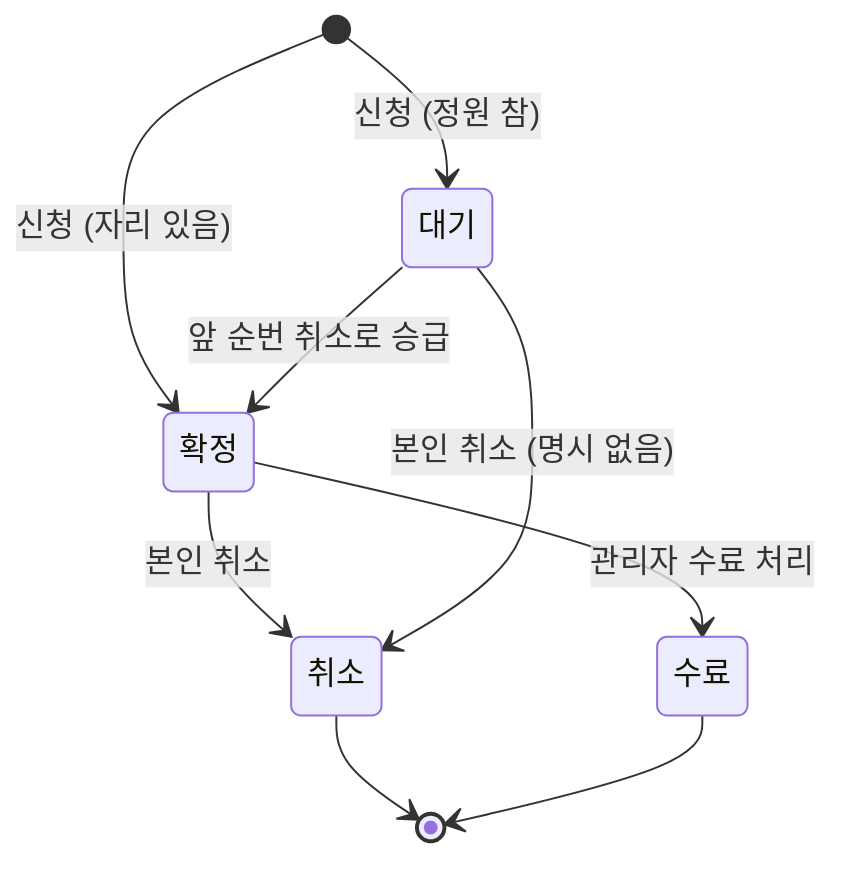

# EduHub 요구사항 분석

- 대상: [requirements.md](requirements.md)의 "개요"와 "기능 요구사항"(FR-01~09)
- 작성일: 2026-11-18
- 상태: 초안. 결정 D-01~03을 반영했다(Q2 일부). 나머지 질문과 Q6·Q7은 답을 기다린다

## 1. 사용자별 요약

- **임직원**: 교육과정을 제목·분류로 검색하고, 과정의 회차별 일정·장소·남은 자리를 본다. (FR-01, 02)
- **임직원**: 회차에 신청한다. 자리가 없으면 대기자가 되고 대기 순번을 안내받는다. (FR-04, 05)
- **임직원**: 신청을 취소할 수 있고, 내 신청 내역(확정·대기·취소·수료)을 본다. (FR-06, 07)
- **교육 담당자**: 과정과 회차를 등록·수정·종료한다. (FR-03)
- **교육 담당자**: 회차별 신청자·대기자 명단을 보고 수료 처리를 한다. (FR-08)

## 2. 도메인 용어와 상태 변화

### 2.1 용어

| 용어 | 뜻 | 관계 |
|---|---|---|
| 과정 | 교육 내용 단위 (제목, 분류) | 과정 1개에 회차 여러 개 |
| 회차 | 과정이 실제로 열리는 한 번 (일정, 장소, 정원) | 회차 1개에 신청 여러 개 |
| 신청 | 임직원 한 명이 회차 하나에 낸 신청 | 같은 사람·같은 회차는 1건만 (FR-04) |
| 대기 | 정원이 찬 회차에 들어온 신청의 상태. 순번이 있다 | 신청의 한 상태 (FR-05) |
| 수료 | 교육을 마쳤다고 관리자가 처리한 상태 | 신청의 마지막 상태 (FR-08) |

### 2.2 신청의 상태 변화

| 지금 상태 | 일어난 일 | 다음 상태 | 근거 |
|---|---|---|---|
| (없음) | 신청, 남은 자리 있음 | 확정 | FR-04 |
| (없음) | 신청, 정원 참 | 대기 (순번 부여) | FR-05 |
| (없음) | 신청, 정원과 대기 상한(정원의 50%)이 모두 참 | 신청 불가 | D-02 |
| 확정 | 본인이 취소 (회차 시작 1일 전까지) | 취소. 대기 1순위가 확정으로 바뀐다 | FR-06, D-01 |
| 대기 | 앞 사람이 취소해 1순위가 됨 | 확정 (알림 기록) | FR-06, 09 |
| 대기 | 본인이 취소 | 취소 *(요구사항에 명시 없음)* | — |
| 확정 | 관리자가 수료 처리 (관리자만) | 수료 | FR-08, D-03 |

### 2.3 과정·회차의 상태

등록 → (수정) → 종료 (FR-03). 회차가 "모집 중", "정원 마감" 같은 상태를 따로 갖는지는 적혀 있지 않다.

## 3. 애매하거나 서로 부딪히는 부분

| 번호 | 질문 | 관련 요구사항 | 답 |
|---|---|---|---|
| Q1 | 회차 "종료"는 무슨 뜻인가? | FR-03 ↔ FR-06, 08 | |
| Q2 | 대기 1순위를 본인 확인 없이 바로 확정해도 되는가? | FR-06 | 일부: D-01. 취소가 시작 1일 전까지라 자동 확정도 그때까지만 일어난다. 본인 확인 여부는 미정 |
| Q3 | 관리자가 정원을 바꾸면 어떻게 되는가? | FR-03 ↔ FR-05, 06 | |
| Q4 | "중복 신청"과 재신청의 범위는? | FR-04 | |
| Q5 | 상태 목록이 충분한가? | FR-07 ↔ FR-05, 08, 09 | |
| Q6 | "회차 시작 1일 전"의 기준 시각은? | D-01 | |
| Q7 | 대기 상한 50%의 계산과 상한에 닿았을 때의 처리는? | D-02, FR-03 | |

### Q1. 회차 "종료"는 무슨 뜻인가?

- 모집 마감, 교육 끝남, 폐강 중 어느 것인가?
- 종료된 회차의 확정·대기 신청은 어떻게 되는가?
- 수료 처리는 종료 전에 하는가, 후에 하는가?
- 종료 뒤에도 취소와 대기 자동 확정이 일어나는가?

### Q2. 대기 1순위를 본인 확인 없이 바로 확정해도 되는가?

- 교육 전날 취소가 생기면 대기자는 갑자기 확정되는데, 참석하지 못할 수 있다.
- 취소 마감 시점이나 자동 확정을 멈추는 시점이 있는가?
- 바로 확정하는 대신 수락 기한을 주는 방식으로 할 것인가?

### Q3. 관리자가 정원을 바꾸면 어떻게 되는가?

- 정원을 늘리면 대기자가 자동으로 확정되는가? (FR-06은 "취소"일 때의 자동 확정만 정한다)
- 이미 확정된 인원보다 적게 줄이는 것을 막는가? 허용한다면 누구를 대기로 돌리는가?

### Q4. "중복 신청"과 재신청의 범위는?

- 같은 회차만 막는다면, 같은 과정의 다른 회차에는 동시에 신청할 수 있는가?
- 취소한 뒤 같은 회차에 다시 신청할 수 있는가? 된다면 대기 순번은 맨 뒤인가?
- 대기 상태도 "신청 1건"으로 쳐서 중복을 막는가?

### Q5. 상태 목록이 충분한가?

- FR-07의 상태는 확정·대기·취소·수료 네 가지다.
- 대기 중에 취소할 수 있는지가 적혀 있지 않다.
- 확정됐는데 수료하지 못한 경우(불참, 미수료)를 나타낼 상태가 없다.
- FR-05의 "순번을 알려 준다"는 화면 표시인가, 알림인가? 순번이 바뀔 때마다 알려 주는가? (FR-09에는 알림이 "선택"으로 되어 있다)

### Q6. "회차 시작 1일 전"의 기준 시각은? (D-01에서 생김)

- 시작 시각의 24시간 전인가, 시작 전날 23:59까지인가?
- 대기 중인 신청의 취소에도 같은 기한을 적용하는가?
- 기한이 지나면 대기자는 어떻게 되는가? 그대로 대기로 남아 있다가 회차가 종료되면 정리되는가?

### Q7. 대기 상한 50%의 계산과 상한에 닿았을 때의 처리는? (D-02에서 생김)

- 정원이 홀수일 때(예: 정원 5명 → 2.5명) 올림인가, 내림인가?
- 대기까지 꽉 찬 회차에 신청하면 "신청 불가"로 막는가? 화면에서 신청 버튼을 미리 막는가?
- 관리자가 정원을 줄여 이미 있는 대기 인원이 새 상한을 넘으면 어떻게 하는가? (Q3과 이어짐)
